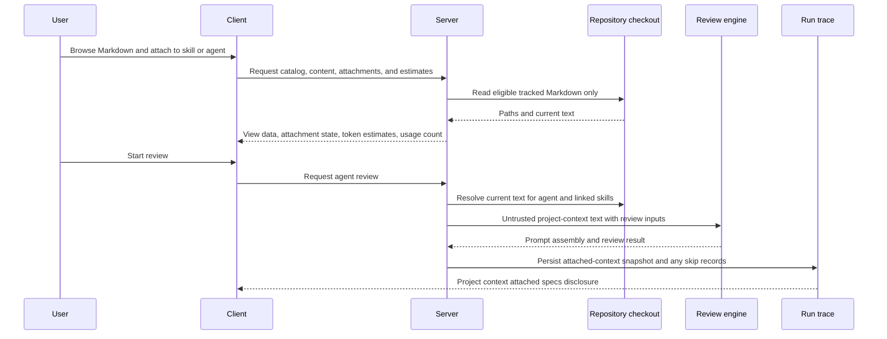

# Spec: Project Context | Spec ID: SPEC-2026-10-23-project-context | Status: approved
Supersedes: none

## Evidence & design sources

- User feature request, 2026-10-23: supports discovery of project Markdown
  documents, attachment to skills or agents, token visibility before a review,
  prompt inclusion, and prompt-assembly inspection.
- User decisions, 2026-10-23: use only Git-tracked Markdown documents; keep the
  first release view-only; skip and record a missing attachment; do not create
  document versions; show how many agents use a skill; inherit skill attachments
  to its linked agents; label the footer `tokens total`.
- User revision, 2026-10-29: recursively discover `.md` files under configurable
  repository directories, defaulting to `specs`, `docs`, and `insights`; keep
  manual selection; show per-document token estimates in the run trace; verify
  the feature against a real reviewer and a PR that violates an attached rule.
- User clarification, 2026-10-29: discover and read only committed documents
  from the repository's `main` branch, not another branch or uncommitted files.
- `DevDigest Design (standalone).html`, Project Context and Project Context
  empty-state artboards: supports the Project Context surface and its
  first-run state.
- Existing product behavior: skills are linked to agents, project-context text
  is an untrusted prompt section, and a run trace exposes Prompt Assembly.
  These facts support inheritance, safe prompt treatment, and run-time
  inspection; they do not prescribe an implementation.

## Problem & why

Review agents need durable project knowledge such as specifications, PRDs, and
acceptance criteria. Users currently cannot reliably discover the eligible
Markdown documents in a project, choose which knowledge applies to a skill or
agent, understand the prompt-context cost before a review, or inspect the
exact project-context text that was supplied to a completed review.

Project Context makes those choices explicit, observable, and recoverable
without turning DevDigest into a repository editor.

## Goals / Non-goals

### Goals

- Discover eligible project Markdown documents for a repository.
- Let a user view a document and attach or detach it from a skill or an agent.
- Show each attachment's estimated token contribution and the current
  attachment set's `tokens total` before a review starts.
- Include the current text of resolved attachments in an eligible agent's
  review prompt as project context.
- Preserve an inspectable snapshot of the project-context text actually added
  to each review prompt, under `Project context attached specs` in Prompt
  Assembly.
- Make a skill's agent usage count visible.
- Degrade safely when an attached file is no longer available.

### Non-goals

- Creating, editing, renaming, deleting, committing, or synchronising project
  files from DevDigest.
- Attaching non-Markdown files, arbitrary filesystem paths, URLs, or uploaded
  content.
- Creating per-document version history or an attachment-version history.
- Guaranteeing a provider-billed token count or a complete final-prompt token
  total that includes the diff, system prompt, memory, or other dynamic
  sections.
- Changing an agent's configured skills or an existing skill-agent link as a
  side effect of attaching project context.
- Automatically selecting documents from the PR content.

## User stories

| ID | Story | Acceptance criteria |
|---|---|---|
| US-1 | As a repository user, I want to find the Markdown documents that DevDigest can use as project context so that I can ground reviews in project-specific requirements. | AC-1, AC-2, AC-3, AC-15 |
| US-2 | As a skill author, I want to attach relevant project documents to a skill and see its agent usage and token total so that every agent using that skill receives the same context knowingly. | AC-4, AC-5, AC-6, AC-7 |
| US-3 | As an agent editor, I want to attach an additional document directly to one agent so that I can provide context without changing its linked skills or other agents. | AC-4, AC-5, AC-7 |
| US-4 | As a reviewer, I want the chosen, current document text to be included in the review prompt so that my findings use the intended project context. | AC-8, AC-9, AC-10, AC-17, AC-18 |
| US-5 | As a user investigating a completed review, I want to open the exact attached context in Prompt Assembly so that I can audit what the agent received. | AC-11, AC-12, AC-16 |
| US-6 | As a user, I want a missing attachment to be visible rather than silently changing the review so that I can repair the configuration. | AC-13, AC-14 |

## Acceptance criteria (EARS)

- **AC-1 — eligible discovery:** WHEN a user opens Project Context for an
  available repository, the system SHALL recursively list committed `.md`
  files from `main` beneath the configured repository directory names or paths, defaulting
  to `specs`, `docs`, and `insights`, and SHALL exclude untracked files,
  generated dependencies, Git metadata, and paths outside those roots;
  **observable:** nested matches appear while a root-level `README.md` does not.
- **AC-2 — read-only viewing:** WHEN a user selects an eligible document, the
  system SHALL display its current text and path without offering a content
  editing or filesystem-mutating action; **observable:** the document can be
  read but no save, rename, delete, or commit control is available.
- **AC-3 — source-unavailable state:** IF Project Context cannot obtain the
  eligible-document list or a selected document's text, THEN the system SHALL
  show that the content is unavailable and preserve the user's existing
  attachments; **observable:** the UI has an error/retry state and no
  attachment is removed by the failed read.
- **AC-4 — owner-scoped attachment:** WHEN a user manually attaches or detaches
  an eligible document in the Context section of an agent or skill editor, the
  system SHALL change only that owner’s attachment set; **observable:** the
  section provides checkboxes, document paths and types, search and preview,
  and an attachment affects no unrelated agent or skill.
- **AC-5 — inheritance:** WHEN an enabled skill with attached documents is
  used by an agent, the system SHALL resolve those skill documents into that
  agent's project context in addition to the agent's direct attachments;
  **observable:** a review by a linked agent lists the skill attachment in its
  resolved context.
- **AC-6 — skill coverage:** WHEN a user views a skill, the system SHALL show
  the count of agents that use that skill; **observable:** the displayed count
  reflects the current skill-agent links.
- **AC-7 — pre-run token estimate:** WHEN a document is attached, detached, or
  its current content is refreshed, the system SHALL show its estimated token
  count and SHALL show the sum for that owner as `tokens total`; **observable:**
  the total equals the sum of the visible attached-document estimates.
- **AC-8 — estimation meaning:** THE system SHALL calculate Project Context
  estimates through one canonical server-side estimator and SHALL identify them
  as estimates, not provider-billed usage; **observable:** the same document
  content receives the same displayed estimate regardless of the agent's model
  provider.
- **AC-9 — current-text resolution:** WHEN an eligible agent review starts,
  the system SHALL read the committed `main` text of every resolved
  attachment before prompt assembly; **observable:** a repository edit made
  and committed to `main` before the run appears in that run's attached context
  without requiring an attachment version.
- **AC-10 — safe prompt inclusion:** WHEN resolved project-context text is
  added to a review prompt, the system SHALL treat it as untrusted data and
  SHALL not allow its contents to change the agent's trusted instructions;
  **observable:** prompt assembly identifies it as project context and applies
  the product's untrusted-content boundary.
- **AC-11 — prompt-assembly disclosure:** WHEN a review has one or more
  successfully resolved attachments, the system SHALL expose a Prompt Assembly
  section labelled `Project context attached specs` containing the full text
  added to that run's request; **observable:** the user can open the section
  after completion and read the exact attached snapshot.
- **AC-12 — run snapshot:** WHEN an attached document changes or is detached
  after a review starts, the system SHALL preserve the prompt-context snapshot
  for that completed run; **observable:** its Prompt Assembly content does not
  change because the repository or later attachment configuration changed.
- **AC-13 — missing attachment:** IF a resolved attachment no longer exists,
  is no longer Git-tracked Markdown, or cannot be read at review start, THEN
  the system SHALL skip it, continue the review with the remaining context, and
  record the path and skip reason in the run trace or log; **observable:** the
  run completes when other required review inputs are available and its trace
  identifies the omitted attachment.
- **AC-14 — missing-context recovery:** WHEN Project Context displays an
  attachment that is missing or unavailable, the system SHALL clearly mark it
  as requiring user attention and SHALL let the user detach it; **observable:**
  the user can identify the path and remove the broken attachment without
  editing project files.
- **AC-15 — changed roots:** WHEN configured roots change, the system SHALL
  retain existing attachment paths that are no longer eligible and mark them
  unavailable; **observable:** they are skipped during review and can be
  detached without modifying repository files.
- **AC-16 — trace estimates:** WHEN a run reads an attached document, the system
  SHALL record its path and estimated token count in the run trace; **observable:**
  the trace shows the actual paths read and their per-document estimates, while
  older traces without estimates remain readable.
- **AC-17 — no selection model call:** WHEN a review resolves Project Context,
  the system SHALL use only manually configured paths without an additional
  LLM request for document selection or inclusion; **observable:** resolving
  attachments causes no separate provider call.
- **AC-18 — real review acceptance:** WHEN a real reviewer runs on a PR that
  directly imports `db/` from `api/` with an attached document forbidding that
  dependency, the review SHALL identify the violation and cite that document;
  **observable:** the completed review identifies the file and invariant.

## Edge cases

| Case | Required behavior | Acceptance criterion |
|---|---|---|
| Repository has no eligible Markdown files | Show the Project Context empty state and no selectable document. | AC-1, AC-3 |
| A document is attached through both a skill and an agent | Include its current text once in the resolved context; the UI keeps each owner relationship visible. | AC-4, AC-5, AC-7 |
| A skill is attached to zero agents | Show usage count `0`; its context remains available for a future linked agent. | AC-6 |
| A skill is disabled or its link to an agent is disabled | Do not resolve that skill's attachments for the agent's review. | AC-5 |
| Current text changes after the token estimate was displayed | Refresh the document estimate before the next run; preserve each prior run's snapshot. | AC-7, AC-9, AC-12 |
| All resolved attachments are unavailable | Run without Project Context, record every omission, and show no false attached-context snapshot. | AC-11, AC-13 |
| Attachment target is outside the eligible catalog | Reject it and do not read the path. | AC-1, AC-4, AC-10 |
| Concurrent attachment changes | A run uses one internally consistent resolved attachment set and records that set in its own trace. | AC-4, AC-12 |
| Previously attached path falls outside changed roots | Retain it as unavailable, skip it during review, and permit detachment. | AC-13, AC-14, AC-15 |

## Non-functional requirements

- **Security:** Only a path returned by the repository's eligible-document
  catalog may be attached or read. Document text is untrusted input and must
  remain isolated from trusted agent instructions. No document content, prompt
  snapshot, or trace may expose credentials beyond what already exists in the
  selected tracked file.
- **Correctness:** The displayed `tokens total` is exactly the sum of the
  canonical estimates for the owner’s currently resolved visible attachments.
  A completed run records the actual resolved paths and the exact prompt text
  sent for them, rather than reconstructing it from later filesystem state.
- **Performance:** Listing attachment metadata and token estimates must not
  require an LLM/provider request. A review must read each distinct resolved
  document at most once for that run.
- **Accessibility:** Attachment controls, token estimates, unavailable status,
  and the `Project context attached specs` disclosure must be keyboard
  operable, have programmatic names, and announce attachment or read failures.
- **Privacy:** Project-context content remains repository-scoped and is shown
  only to users already permitted to view the corresponding repository and run
  trace.

## Cross-module interactions

| Participants | Direction and contract shape | Failure behavior |
|---|---|---|
| Client ↔ Server | Repository-scoped eligible document: `path`, current readable content when requested, availability, and estimated tokens. Attachment: `owner kind`, `owner identity`, `path`, and display/availability state. | Surface readable error state; preserve persisted attachments. |
| Server ↔ repository checkout | Server requests only eligible `.md` paths and contents from a single committed `main` snapshot. | Missing, unreadable, or ineligible paths are not passed to prompt assembly; a run records a skip reason. |
| Server → review engine | Ordered, de-duplicated current document text resolved from direct agent attachments and enabled linked-skill attachments, marked as untrusted project context. | Omit unavailable entries; do not replace them with stale or fabricated content. |
| Review engine → run trace → Client | Snapshot of the full added project-context text, resolved paths, and skipped-path reasons. | A trace has no attached-spec section when none resolved; it still exposes skip information when omissions occurred. |
| Skill ↔ Agent | A skill exposes its current number of linked agents and contributes its attachments only to agents with an enabled link. | Detached/disabled links no longer contribute future-run context; historical traces remain unchanged. |

## Contracts

### Eligible project document

- `path`: repository-relative `.md` path committed on `main` below a configured root.
- `content`: committed `main` text when viewing or resolving for a run; absent when
  unavailable.
- `availability`: available, missing, unreadable, or no-longer-eligible.
- `estimated tokens`: non-negative canonical estimate of the current content;
  clearly labelled as estimated.

### Attachment

- `owner`: exactly one skill or agent in the current repository/workspace.
- `document path`: one eligible project-document path.
- `status`: attached, missing, unreadable, or no-longer-eligible.
- `origin in an agent run`: direct-agent or linked-skill attachment.

### Resolved Project Context for a run

- `resolved paths`: ordered, de-duplicated document paths that were successfully
  read.
- `text`: exact untrusted text included in the prompt for each resolved path.
- `skipped entries`: path plus non-sensitive reason for every configured
  attachment that was not included.
- `snapshot`: immutable for the completed run.

## Untrusted inputs

Repository Markdown, attachment paths received from the client, and all text
included as Project Context are untrusted. The server must authorise the
repository/workspace, accept only catalogued repository-relative paths, prevent
path escape and symlink escape, and treat document text as data in the prompt.
No document may grant itself attachment permission, alter review instructions,
or bypass the existing prompt-injection boundary.

## Design review & UX recommendations

- **Priority: high. Status: accepted decision.** Show `estimated tokens` per
  selected document and `tokens total` in the active skill/agent attachment
  footer. **User impact:** users can judge prompt-context cost before a review
  instead of discovering it from billed usage afterwards.
- **Priority: high. Status: accepted decision.** Keep the Project Context
  document browser view-only. **User impact:** users cannot accidentally make
  a repository clone dirty or lose local Git changes through DevDigest.
- **Priority: high. Status: accepted decision.** Display missing attachments
  inline with path and status, and offer detach. **User impact:** a review does
  not silently lose grounding after a file move or deletion.
- **Priority: medium. Status: accepted decision.** Use distinct origin labels
  for direct-agent and linked-skill context in agent views. **User impact:**
  users can understand why a document affects a particular agent.
- **Priority: high. Status: accepted decision.** In completed runs, expose the
  exact snapshot under `Project context attached specs`, not merely a list of
  filenames. **User impact:** the review is auditable even if files change
  later.
- **Priority: low. Status: deferred recommendation.** Add filtering/search for
  large document catalogs. **User impact:** improves discovery in large
  repositories but is not required for correct attachment or review behavior.

## Open questions

None. The approved scope uses a canonical server-side estimate, not an
agent-model-specific or provider-billed token count.
