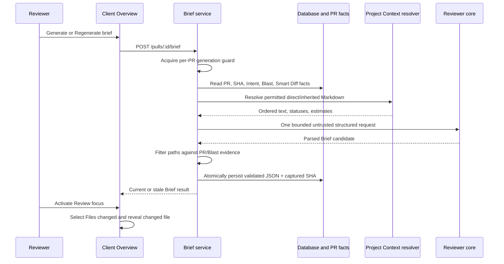

# Spec: PR Why + Risk Brief | Spec ID: SPEC-2026-10-24-pr-brief | Status: approved
Supersedes: none

## Evidence & design sources

- User feature request and supplied PR-detail screenshots, 2026-10-23: define
  the cold-review problem, the Overview placement, the required Brief contents,
  and the P1/P2/P3 priorities.
- User decisions, 2026-10-23 and 2026-10-24: approve an 8,000 estimated-token
  model-input budget; explicit regeneration rather than automatic model calls;
  a SHA-aware cached Brief; read-only Project Context attachments; and one
  generation in flight per PR.
- `docs/specs/2026-10-23-project-context.md`: the approved contract for
  tracked-Markdown discovery, direct and inherited attachments, de-duplication,
  unavailable-document handling, and untrusted prompt context.
- Repository evidence: the shared `brief.ts` contract and `pr_brief` table
  already provide the Brief vocabulary and JSON cache; Intent, Blast Radius,
  Smart Diff, feature-model selection, the Overview tab, and the Files changed
  tab already exist. They establish integration constraints, not a prescribed
  implementation.
- `lesson-5-lab/sdd-finish` was considered only as an implementation reference
  for the Project Context prerequisite. This specification adopts no document
  writing capability from that branch.

## Problem & why

A reviewer who opens an unfamiliar pull request has to reconstruct the purpose,
risk, and recommended reading order from several separate surfaces. DevDigest
already derives useful facts—Intent, Smart Diff, and Blast Radius—but does not
present them as a concise, persisted review starting point.

PR Why + Risk Brief creates one PR-scoped Overview artifact. A single,
explicitly requested model call turns bounded, precomputed facts and permitted
project specifications into a concise summary, file-backed risks, and a
review-reading order. It never asks the model to read diff hunks.

## Goals / non-goals

### Goals

- Show a PR Brief on the pull-request Overview tab, with a generate action
  when none exists and an explicit regenerate action when one exists.
- Persist a model-produced `summary`, `risks`, and `review_focus` with the PR
  head SHA so reopening or reloading the page makes no model call.
- Construct exactly one bounded Brief request from PR facts, optional derived
  facts, and allowed attached Markdown specifications; do not include diff
  hunk bodies.
- Validate model output and reject file references that are not grounded in the
  current PR or Blast Radius evidence.
- Make every Review focus item take the reviewer to the corresponding changed
  file in Files changed. Precise line scrolling is included where feasible but
  is not required for P1.
- Provide the minimal read-only Project Context capability needed to resolve
  permitted direct and inherited Markdown attachments for a Brief.

### Non-goals

- Automatically generating, refreshing, or retrying a Brief on page load, PR
  sync, timer, review completion, or a head-SHA change.
- Sending a diff hunk, raw source code, full repository map, credentials, or
  an arbitrary local path to the Brief model.
- Editing, uploading, renaming, deleting, committing, or synchronising a
  project document from DevDigest.
- Making a Brief a review finding, changing review grounding, or changing an
  agent review's model call.
- P3-only presentation enhancements: latest-review verdict/score banner,
  expandable risk explanations, risk-to-diff navigation, and a dedicated
  missing-diff-file message.

## Scope and delivery priority

| Priority | Included behavior |
|---|---|
| P1 — mandatory | Cached Brief generation/display, summary, risks, Review focus, optional Intent and Blast Radius neighboring panels, file-reference grounding, changed-file navigation, reload persistence, explicit refresh, read-only attachment resolution, localized failure/loading states needed to complete the flow, and deterministic mock-backed browser verification. |
| P2 — include where feasible | 8,000-token evidence, trace/log proof of exactly one call, SHA stale state, deterministic line scrolling, shared-contract parity, configuration via `risk_brief`, plan/verification artifacts, and source-budget observability. |
| P3 — deferred | Verdict/score banner, collapsible risk explanations, risk navigation, a dedicated `File not in this PR's diff` message, and a bespoke Brief skeleton beyond the ordinary pending state required for P1. |

## User stories

| ID | Story | Acceptance criteria |
|---|---|---|
| US-1 | As a reviewer, I want to generate a concise Brief for an unfamiliar PR so that I know what changed, why, and where to start. | AC-1–AC-7 |
| US-2 | As a reviewer, I want reloads to show the saved Brief without another provider call so that I control cost and can resume work. | AC-8–AC-11 |
| US-3 | As a reviewer, I want each Brief reference grounded in known files and Review focus links to open the diff so that the artifact is actionable and trustworthy. | AC-12–AC-15 |
| US-4 | As a project owner, I want attached tracked Markdown specifications to ground the Brief without making DevDigest a file editor. | AC-16–AC-20 |
| US-5 | As an operator, I want concurrent requests and failures to be explicit and safe so that a PR cannot cause duplicate LLM spend or corrupt its cache. | AC-21–AC-25 |

## Acceptance criteria (EARS)

### Brief lifecycle and presentation

- **AC-1 — empty Brief:** WHEN an authorised user opens a PR Overview whose
  Brief cache is absent, THEN the system SHALL show a labelled `PR Brief`
  region and an enabled `Generate brief` control; **observable:** no model call
  occurs from the GET/render path.
- **AC-2 — explicit generation:** WHEN an authorised user activates `Generate
  brief` or `Regenerate`, THEN the system SHALL request one Brief generation
  for that PR and SHALL present a disabled, labelled pending state until it
  settles; **observable:** one activation produces at most one provider call.
- **AC-3 — completed content:** WHEN Brief generation succeeds, THEN the system
  SHALL display its concise summary, a `Risk areas` list, and a `Review focus —
  read these first` list; **observable:** every risk displays title and file,
  and every focus item displays `file:line` and its reason.
- **AC-4 — optional derived facts:** WHEN current Intent and/or Blast Radius is
  available, THEN the Overview SHALL place the available panel(s) alongside or
  adjacent to the Brief; WHEN either is unavailable, THEN Brief generation
  SHALL continue without it and SHALL identify that source as unavailable in
  its source-status information; **observable:** absence of either enrichment
  neither blocks a Brief nor looks like a successful empty result.
- **AC-5 — source distinction:** WHEN an optional source cannot be obtained,
  THEN the system SHALL preserve `unavailable` separately from an available
  source with no entries; **observable:** UI and API do not make a false
  no-risk/no-impact/no-history claim from an unavailable source.
- **AC-6 — localized completion failures:** IF generation fails before a
  validated cache record is persisted, THEN the system SHALL retain any prior
  cache, end the pending state, and show a local retryable error; **observable:**
  the user can retry explicitly and no fabricated Brief is displayed.
- **AC-7 — accessible controls:** WHEN the Brief region is rendered, THEN its
  generate/regenerate actions, pending state, stale notice, risks, and focus
  links SHALL be keyboard operable, have programmatic names, and announce
  asynchronous success or failure; **observable:** assistive technology can
  discover action state and each navigation target.

### Cache and SHA semantics

- **AC-8 — persisted reuse:** WHEN a cache record exists for a PR, THEN
  `GET /pulls/:id/brief` SHALL return that persisted result and SHALL never
  invoke an LLM; **observable:** reloading the Overview displays the record
  without a generation request or provider call.
- **AC-9 — current cache:** WHEN the cached `head_sha` equals the PR's current
  head SHA, THEN GET SHALL report the Brief as `current`; **observable:** the
  UI shows the saved Brief and a `Regenerate` action.
- **AC-10 — stale cache:** WHEN the cached `head_sha` differs from the PR's
  current head SHA, THEN GET SHALL return the saved Brief with status `stale`;
  the UI SHALL visibly say it is out of date and offer `Regenerate`; **observable:**
  no automatic provider call is made because a new commit arrived.
- **AC-11 — explicit replacement:** WHEN a successful explicit generation is
  requested, THEN the system SHALL replace the PR's prior cached JSON atomically
  with the new validated result and the SHA observed at generation start;
  **observable:** a request that starts on an old head can only become a stale
  result, never be labelled current for a later head.

### Grounding and diff navigation

- **AC-12 — risk file grounding:** WHEN a validated model response contains a
  Risk area file reference, THEN the system SHALL retain it only if it exactly
  matches a current PR changed-file path or a path represented by current Blast
  Radius evidence; **observable:** a model-invented, absolute, or traversal
  path is absent from the saved Brief.
- **AC-13 — focus file grounding:** WHEN a validated model response contains a
  Review focus item, THEN the system SHALL retain it only if its file exactly
  matches a current PR changed-file path and its line is a positive integer;
  **observable:** every displayed P1 focus item has a Files changed target.
- **AC-14 — focus navigation:** WHEN a user activates a Review focus item, THEN
  the client SHALL select the Files changed tab and reveal the referenced PR
  file; **observable:** the target file is expanded/visible after navigation.
- **AC-15 — line precision:** WHEN the referenced positive line occurs in the
  rendered patch, THEN the client SHOULD scroll it into view and give it a
  non-disruptive temporary visual focus; WHEN it does not occur, THEN the
  client SHALL still reveal the target file without inventing a line anchor.

### Read-only Project Context input

- **AC-16 — eligible attachments:** WHEN a Brief resolves Project Context, THEN
  it SHALL consider only repository-scoped, Git-tracked Markdown attachments
  permitted by the approved Project Context contract; **observable:** URLs,
  uploads, untracked files, absolute paths, and arbitrary filesystem paths are
  never read for Brief generation.
- **AC-17 — attachment origins:** WHEN an enabled review agent has direct
  attachments or attachments inherited through enabled linked skills, THEN the
  Brief input SHALL resolve their union; **observable:** each resolved document
  has direct-agent or linked-skill provenance internally, while duplicate paths
  appear once in the constructed model input.
- **AC-18 — deterministic attachment order:** WHEN multiple permitted
  documents are resolved, THEN the system SHALL de-duplicate by normalised
  repository-relative path and process the distinct paths in ascending stable
  path order; **observable:** equal source state produces equal document order.
- **AC-19 — missing attachment:** IF an attached document is missing,
  unreadable, no longer eligible, or fails repository-boundary validation, THEN
  the system SHALL skip it, record a non-sensitive path and reason in Brief
  source-status/trace data, and continue with remaining inputs; **observable:**
  a bad attachment neither reads outside the checkout nor blocks an otherwise
  possible Brief.
- **AC-20 — no document mutation:** WHEN a user uses the prerequisite Project
  Context surface, THEN the system SHALL offer read, attach, detach, status,
  and token-estimate operations only; **observable:** it exposes no document
  save, edit, rename, delete, upload, commit, or sync action.

### Model call, budget, and concurrency

- **AC-21 — one structured call:** WHEN generation proceeds after collecting
  inputs, THEN the system SHALL call the configured `risk_brief` model exactly
  once through the structured-output boundary with a schema for `summary`,
  `risks`, and `review_focus`; **observable:** trace/log telemetry records one
  request attempt for a successful explicit generation, excluding provider
  protocol-level JSON repair that the existing structured client owns.
- **AC-22 — bounded input:** WHEN the model request is constructed, THEN its
  constructed untrusted input SHALL be at most 8,000 estimated tokens under one
  canonical estimator; **observable:** the recorded estimated total is at most
  8,000 and no diff hunk body is present.
- **AC-23 — deterministic budget allocation:** WHEN inputs exceed the budget,
  THEN the system SHALL allocate up to 4,000 estimated tokens to compact PR
  facts first, then allocate remaining capacity to attached specifications in
  stable path order, with no document contributing more than 2,000 estimated
  tokens; unused PR-fact capacity MAY pass to specifications; **observable:**
  the recorded source selection explains omitted/truncated sources without
  logging their content.
- **AC-24 — model configuration:** WHEN generation selects a provider and
  model, THEN it SHALL resolve the workspace's `risk_brief` feature-model
  setting using the existing feature-model mechanism; **observable:** no Brief
  model/provider is hardcoded in the Brief module.
- **AC-25 — in-flight exclusion:** IF a generation is already in flight for the
  same PR, THEN a concurrent POST SHALL return a clear in-progress conflict and
  SHALL not start a second model call; **observable:** parallel requests yield
  one owner and one `409` conflict response. The lock is released on success or
  failure and is scoped to the process's existing single-API-process model.

## Required input and budget contract

The server constructs a Brief input from data it already owns or has safely
resolved. It must label every such section as untrusted data; model-facing
instructions and the output schema remain trusted.

| Source | Inclusion and priority | Model content rule |
|---|---|---|
| PR metadata | First within the 4,000-token facts reservation: title, body, PR number, head SHA, linked-issue title/body when already available. | Compact text/metadata only; no credentials or raw diff hunks. |
| Intent | Include current derived Intent when available; otherwise source status. | Intent, scope lists, confidence; no hidden provenance text. |
| Blast Radius | Include compact `summary` plus changed-file/caller path evidence when available; otherwise source status. | No full index or unrelated code. |
| Diff facts | Include changed-file paths, additions/deletions, totals, and Smart Diff roles/short summaries when available. | Never include patch/hunk/body/source-code content. |
| Project Context | After facts, include permitted attachment text subject to remaining budget, 2,000 estimated tokens/document, sorted by path. | Markdown is untrusted data, is fenced/delimited by the existing injection guard, and can never issue instructions. |

The 4,000-token facts reservation is an upper bound, not a requirement to pad
the prompt. If facts use less, the unspent portion is available to specifications.
If a source cannot fit, the server records its path/type and a non-sensitive
reason such as `budget_exhausted`; it does not silently claim the source was
used. Token estimates are capacity controls, not provider-billed usage.

## Contracts

### Shared Brief vocabulary

Both vendored copies of `@devdigest/shared/contracts/brief.ts` SHALL remain
identical for the public Brief schema. `PrBrief` SHALL add:

- `summary`: non-empty concise explanation of what the PR does and why.
- `review_focus`: ordered array of `{ file, line, reason }`, where `file` is a
  repository-relative path and `line` is a positive integer.
- `head_sha`: SHA for the source state used to construct the cached Brief.

`risks` retains `kind`, `title`, `explanation`, `severity`, and `file_refs`.
The persisted Brief is model output after server validation/filtering; it is not
a raw provider response.

### Read endpoint

`GET /pulls/:id/brief` is repository/workspace authorised and returns a
discriminated cache state:

| State | Required response meaning |
|---|---|
| `missing` | No persisted Brief exists; `brief` is absent/null. |
| `current` | Persisted Brief exists and its `head_sha` equals current PR head. |
| `stale` | Persisted Brief exists but its `head_sha` differs from current PR head. |

The endpoint has no side effect and never resolves a model, starts a job, or
changes the cache.

### Generate endpoint

`POST /pulls/:id/brief` is repository/workspace authorised and means explicit
generation or replacement. It returns the validated cache representation on
success. It returns:

- `409` with a stable in-progress error code if that PR already has an active
  generation in this API process;
- a structured client-safe failure if required PR data, the configured model,
  or the provider cannot supply a validated result;
- no partial or unvalidated Brief and no destruction of an earlier cache on
  failure.

### Source status and observability

The generation result/trace SHALL retain compact status metadata sufficient to
audit source selection: available/unavailable/omitted status, reason codes,
estimated token totals, resolved attachment paths, skipped attachment paths,
the SHA snapshot, selected model identity, and Brief-call count. It SHALL NOT
persist raw prompt text, project-document content, provider credentials, or
the model's unvalidated raw response merely for Brief telemetry.

## Edge cases

| Case | Required behavior | Acceptance criteria |
|---|---|---|
| No Intent or Blast Radius feature/data | Generate from available PR facts/specifications; mark unavailable source(s) distinctly. | AC-4, AC-5 |
| No attachments | Generate from bounded PR facts only. | AC-16–AC-23 |
| Same attachment is direct and inherited or used by multiple enabled agents | Resolve content once, retaining provenance only in status metadata. | AC-17, AC-18 |
| All attachments fail to resolve | Generate without Project Context when other required facts/model availability permit; record skips. | AC-19 |
| Model supplies no risks/focus after schema validation | Persist and render empty states, not a fabricated risk/focus item. | AC-3, AC-6 |
| Model returns a Risk path outside both allowed sets | Drop that file reference; drop the Risk if no valid file references remain. | AC-12 |
| Model returns Review focus for a Blast-only file | Drop it because it lacks a P1 diff target. | AC-13, AC-14 |
| Head changes during generation | Save against the captured starting SHA; GET reports it stale if current head differs. | AC-10, AC-11 |
| Refresh clicked while a request is pending | Keep the first request owner; report the second as in progress and do not spend again. | AC-2, AC-25 |
| Reload during/after generation | Read only persisted state; an interrupted/in-flight generation appears missing or prior cached state until a later explicit retry. | AC-8, AC-25 |
| Focus line is absent from available patch | Reveal the target file; do not claim precision scrolling. | AC-15 |

## Security, privacy, correctness, and performance

- **Authorization and tenancy:** all Brief and Project Context operations use
  the existing workspace/repository context. A PR ID alone grants no access.
- **Filesystem boundary:** attachments are accepted only from the eligible
  tracked-Markdown catalog. Normalise and validate repository-relative paths;
  reject absolute paths, traversal, and symlink escape before reading.
- **Prompt-injection boundary:** PR title/body, linked issues, Smart Diff text,
  Blast text, Markdown specifications, model output, and paths are untrusted.
  Existing delimiter wrapping/injection guards protect trusted Brief
  instructions. A document cannot change its own inclusion or model behavior.
- **Secrets:** do not log, persist in telemetry, or display provider secrets or
  raw prompt text. The server secrets provider remains the only runtime
  credential chokepoint.
- **Output correctness:** structured parsing precedes persistence; file
  filtering precedes persistence; cached JSON is written atomically only after
  both succeed. Never treat `null`/unavailable enrichment as an empty success.
- **Performance/cost:** GET is cache-only. A successful POST performs at most
  one Brief LLM request, reads each distinct attached document at most once,
  and uses no diff hunk body. The in-process concurrency guard is explicitly
  not multi-replica coordination.
- **Accessibility:** use semantic region/headings and buttons/links; preserve
  focus during tab navigation; expose status/error messages with suitable live
  announcements; do not use colour alone for risk severity or stale status.

## Cross-module interactions

| Modules | Responsibility and boundary |
|---|---|
| Server | Owns authorised routes, cache persistence, SHA freshness evaluation, per-process in-flight exclusion, bounded fact assembly, Project Context repository boundary, model configuration lookup, filtering, and safe telemetry. |
| Reviewer core | Owns trusted/untrusted prompt construction, structured model call, schema parsing, and injection guard. It does not read a checkout, database, or HTTP request. |
| Shared contracts | Own identical Brief schemas in both vendored copies and define transport-safe response shapes. |
| Client | Fetches cache state, triggers only explicit POSTs, renders Brief/failure/stale/pending states, and translates validated focus paths into tab/file navigation. |
| E2E | Proves the browser journey against a seeded/mock fixture with no live LLM/provider call. |

## Verification requirements

- Server unit tests cover budget ordering/caps, excluded diff hunks, unavailable
  versus empty sources, attachment de-duplication/skip reasons, SHA statuses,
  one-call generation, model-setting resolution, invalid output/file filtering,
  and `409` concurrent generation behavior using mocks.
- A persistence/integration test covers cache replacement and reload-safe GET
  semantics with a real migration chain when schema changes are introduced.
- Reviewer-core tests cover untrusted Brief slots, the structured Brief schema,
  and no provider/network dependency.
- Client tests cover missing/current/stale/pending/error states, risk/focus
  rendering, keyboard-accessible actions, and URL/tab/file navigation.
- A deterministic E2E flow uses a mocked/fixture Brief response and seeded PR.
  It MUST demonstrate Generate, completed summary/risk/focus, focus navigation
  to Files changed, and reload persistence. It MUST NOT configure or invoke a
  live LLM.
- Verification reports distinguish hermetic tests from Docker-backed migration
  tests and browser evidence; they do not claim unrun checks passed.

## Traceability

| Requested outcome | Specification coverage |
|---|---|
| One Overview Brief with purpose, risk, and first files to inspect | Goals; AC-1–AC-4 |
| One model call over facts, not diff code | Required input contract; AC-21–AC-24 |
| 8,000 estimated-token ceiling and attached specs | Required input contract; AC-16–AC-23 |
| Use read-only Project Context from the lesson reference | Goals; AC-16–AC-20 |
| Persist/reload and explicit refresh | AC-2, AC-8–AC-11 |
| SHA-aware stale handling without automatic spend | AC-8–AC-11 |
| No invented file paths | AC-12–AC-13 |
| Review focus opens Files changed | AC-14–AC-15 |
| One concurrent generation per PR | AC-25 |
| P1 deliverable and deterministic browser proof | Scope table; Verification requirements |

## Open questions

None. This draft fixes the attachment aggregation rule as the de-duplicated
union of direct and inherited attachments of enabled review agents, because a
PR-scoped Brief does not select a single agent. Any future per-Brief attachment
selector is a separate product change.
