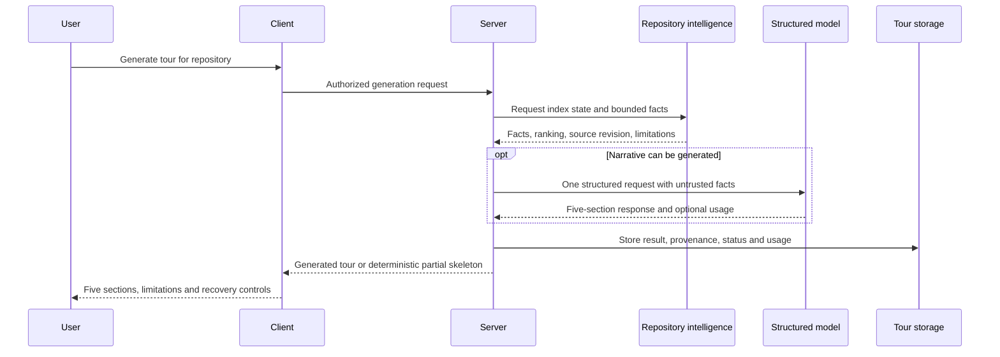

# Spec: Onboarding Generator | Spec ID: SPEC-2026-10-29-onboarding-generator | Status: draft
Supersedes: none

## Evidence & design sources

- The user's laboratory assignment and 2026-10-29 clarification: a repository tour with five sections; deterministic repository facts; an import-graph-ranked reading path; one structured narrative LLM call; an honest deterministic skeleton when the index or model is unavailable; and a demonstration with call count and cost.
- User decisions, 2026-10-29: display a partial deterministic tour when a checkout or index is unavailable; keep the previous tour visible with failure and retry on failed regeneration; support workspace-authorized tour links.
- User decisions, 2026-10-29: cap indexed input at 5,000 files and narrative facts at 12,000 estimated tokens with truncation disclosure; allow clearly labelled exploratory first-task suggestions grounded in facts; show call count and available cost on the tour page and in logs.
- The supplied Onboarding Tour screenshots: repository-scoped sidebar entry, page navigation, five expandable sections, architecture diagram, file links, numbered commands with copy actions, regenerate, share, and index/freshness information. These images are design evidence, not proof those actions already exist.
- `server/src/modules/repo-intel/types.ts` and `service.ts`: the existing repository intelligence boundary exposes index status, ranked paths, and dependency chains. `pipeline/rank.ts` records the current shallow-clone limitation: hotness is unavailable and ranking currently reduces to PageRank.
- The existing onboarding structured prompt and shared onboarding contract describe prior groundwork; `server/src/modules/index.ts` has no onboarding feature registered and the client navigation has no tour entry. `/onboarding` is currently the add-repository flow and is not this tour.
- The approved Project Context specification concerns review grounding and does not specify this feature.

## Problem & why

A developer opening an unfamiliar repository needs a trustworthy route from its architecture to practical first tasks. A model-generated tour can invent files, commands, or structure, and a large, partially indexed, or unavailable checkout cannot support a complete architectural account. The product must distinguish a grounded narrative from a partial deterministic summary and explain the evidence available for either.

## Goals / Non-goals

### Goals

- Generate a repository-scoped tour with exactly five ordered sections: Architecture overview, Critical paths, How to run locally, Guided reading path, and First tasks.
- Gather repository facts deterministically and make the reading order depend on import-graph rank and available hotness.
- Produce the narrative in at most one structured LLM request per generation attempt, with no additional per-section LLM requests.
- Preserve and display the generated result, its source/index freshness, generation status, and available usage information.
- Provide a deterministic, explicitly partial skeleton when required indexed facts or narrative generation are unavailable.
- Let an authorized user inspect the tour, open supported file links, copy displayed commands, regenerate, and share an authorized workspace-scoped link.

### Non-goals

- Modifying repository files, executing generated commands, cloning additional history merely to estimate hotness, or automatically completing first tasks.
- Claiming that a partial index or a model's generated statements prove exhaustive architecture, security, or correctness.
- Automatically publishing repository content outside the workspace or creating a public share link.
- Per-section model calls, autonomous tool use by the model, or paid generation without a user-triggered request.

## User stories

| ID | Story | Acceptance criteria |
|---|---|---|
| US-1 | As a developer, I can find and generate a tour for the active repository. | AC-1, AC-2, AC-3, AC-4 |
| US-2 | I can read five grounded sections and follow the ranked reading path. | AC-5, AC-6, AC-7, AC-8, AC-9 |
| US-3 | I can understand and recover from incomplete source data or a failed model request. | AC-10, AC-11, AC-12, AC-13, AC-14 |
| US-4 | I can revisit a result, see its freshness, regenerate it, and share access safely. | AC-15, AC-16, AC-17, AC-18 |
| US-5 | I can inspect request count and cost without mistaking unavailable usage for zero. | AC-19, AC-20 |
| US-6 | I can use the page with keyboard and assistive technology. | AC-21, AC-22 |

## Acceptance criteria (EARS)

- **AC-1 — entry:** WHEN an authorized user selects Onboarding Tour for a repository, THE system SHALL open that repository's tour surface; **observable:** the repository identity and an existing result or a generate/empty state are visible.
- **AC-2 — explicit generation:** WHEN a user starts generation, THE system SHALL show an in-progress state until the attempt reaches a terminal result; **observable:** the UI prevents a second active request for the same repository and exposes progress or an equivalent pending indication.
- **AC-3 — deterministic inputs:** WHEN a generation attempt starts, THE system SHALL collect available stack, repository structure, routes, scripts, file-rank and dependency facts without a model request; **observable:** identical source facts produce identical selected fact sets and ordering.
- **AC-4 — bounded input:** WHEN a repository exceeds 5,000 indexed files or 12,000 estimated tokens of narrative facts, THE system SHALL use a deterministic bounded selection and disclose truncation; **observable:** the tour identifies itself as partial and reports indexed and omitted counts when known.
- **AC-5 — five sections:** WHEN a tour is displayed, THE system SHALL present the five named sections in the order listed in Goals; **observable:** each section is independently identifiable even when its evidence is unavailable.
- **AC-6 — narrative call limit:** WHEN the required facts and a provider are available for narrative generation, THE system SHALL make exactly one structured LLM request for that attempt; **observable:** provider-call instrumentation records one request and no per-section requests or retries.
- **AC-7 — ranked reading path:** WHEN usable import-graph ranks exist, THE system SHALL order reading-path files by descending graph-derived rank adjusted by available hotness, with a deterministic tie-breaker; **observable:** changing the ranked inputs changes the order predictably and an absent hotness signal is reported as unavailable rather than represented as measured zero activity.
- **AC-8 — grounded output:** WHEN a narrative refers to a file, route, dependency, or command, THE system SHALL use only evidence supplied for that run; **observable:** unsupported paths, routes, dependencies and commands are removed or identified as unavailable before display.
- **AC-9 — section content:** WHEN sufficient facts are available, THE system SHALL show the architecture, critical dependency paths, repository-supported local commands, ranked file-reading path, and clearly labelled exploratory first-task suggestions in their corresponding sections; **observable:** each item is traceable to supplied facts, issue or TODO claims have a source, and unsupported sections explicitly say what is unavailable.
- **AC-10 — model failure:** IF the structured response is unavailable, invalid, or the provider fails and no earlier tour exists, THEN THE system SHALL display a deterministic skeleton from available facts with a model-unavailable or invalid-response status; **observable:** no narrative is presented as successfully generated.
- **AC-11 — incomplete index:** IF the repository index is incomplete, stale, bounded, or degraded, THEN THE system SHALL show the applicable limitations and use available facts without claiming full coverage; **observable:** the user can distinguish partial evidence from a complete index.
- **AC-12 — no usable graph:** IF import-graph ranking is unavailable, THEN THE system SHALL show a deterministic fallback list when eligible file facts exist and label its order as unranked; **observable:** the fallback does not present fabricated rank or hotness.
- **AC-13 — incomplete checkout:** IF a full checkout is unavailable, THEN THE system SHALL display a partial deterministic skeleton from accessible facts and disclose the missing source; **observable:** unavailable paths and commands are not invented.
- **AC-14 — recovery:** WHEN the current attempt cannot produce a full tour, THE system SHALL expose the reason and a retry action when retry is possible; **observable:** the user can distinguish source, index, authorization, and model failures without seeing sensitive error payloads.
- **AC-15 — persistence:** WHEN a generation attempt reaches an accepted terminal result, THE system SHALL store the tour and its source identity, status, generation time and usage metadata for that repository; **observable:** reopening the page returns the persisted result rather than issuing a new LLM request.
- **AC-16 — freshness:** WHEN a stored tour's source revision differs from the repository's current indexed revision, THE system SHALL mark the tour stale; **observable:** source revision, generation time and stale/unknown state are visible without asserting freshness when the current revision is unavailable.
- **AC-17 — regeneration:** IF regeneration fails, THEN THE system SHALL retain the previous tour and display the failure with a retry action; **observable:** the existing result remains readable throughout the attempt and after the failure.
- **AC-18 — authorization and sharing:** WHEN a user opens a tour link, THE system SHALL enforce the same workspace and repository access rules as direct access; **observable:** an unauthorized user receives no tour content and a shared link does not make the tour public.
- **AC-19 — observability:** WHEN a generation attempt completes or fails, THE system SHALL expose its outcome, narrative request count, token usage when supplied, and cost when available on the tour page and in operational logs; **observable:** a tester can inspect these values without exposing source text, prompts, or secrets in logs.
- **AC-20 — unknown usage:** IF provider usage or cost is unavailable, THEN THE system SHALL display and record it as unavailable; **observable:** unknown is distinguishable from a zero-cost request.
- **AC-21 — accessible controls:** WHEN a user navigates by keyboard, THE system SHALL provide operable, named controls for section disclosure, regenerate, copy, and available share/file actions; **observable:** focus, expanded state and action results are exposed to assistive technology.
- **AC-22 — command handling:** WHEN a user copies a local-run command, THE system SHALL copy only the displayed command and report success or failure; **observable:** no command is executed and credentials or configuration values are not inserted.

## Edge cases

| Condition | Required outcome | Coverage |
|---|---|---|
| No tour exists | Show an empty state with generate action. | AC-1, AC-2 |
| Very large repository or input truncation | Bound selection, show partial status and known counts. | AC-3, AC-4, AC-11 |
| No checkout, partial clone, or index not ready | Show only available facts and explain omissions; no invented paths. | AC-11, AC-13, AC-14 |
| No graph edges or no usable ranks | Show an explicitly unranked fallback or unavailable section. | AC-7, AC-12 |
| Shallow history or unavailable hotness | Rank using available graph data; disclose unavailable hotness. | AC-7 |
| Missing credentials, invalid structured output, timeout, or provider error | Keep an existing tour with failure and retry; otherwise show a deterministic skeleton and recoverable status. | AC-10, AC-14, AC-17, AC-19 |
| Concurrent generation requests | Admit at most one active attempt per repository and indicate the existing attempt. | AC-2 |
| Source changes while a tour is being generated | Attribute the result to its captured source revision; mark stale when current source differs. | AC-15, AC-16 |
| A linked file no longer exists or cannot be opened | Report it unavailable; do not redirect to an arbitrary path. | AC-8, AC-14, AC-18 |
| Usage or cost missing | Show unavailable rather than zero. | AC-20 |

## Non-functional requirements

- **Bounded work:** generation uses at most 5,000 indexed files, 12,000 estimated tokens of narrative facts, and one narrative LLM request. Truncation is disclosed; no completeness claim may be made for omitted files. Token estimates are labelled as estimates, not provider-billed usage.
- **Determinism:** with identical source facts and limits, the selected fact set, fallback skeleton, ranking tie-breaks, and fallback order are identical. Generated prose is not required to be deterministic.
- **Security and privacy:** every read and generation is authorized for the current workspace and repository; only repository-relative, authorized file references are openable. Repository files, comments, docs, and model output are untrusted. Never execute source-derived commands, render executable HTML, follow arbitrary URLs from generated output, or log repository content, credentials, or prompt bodies.
- **Accessibility:** controls meet AC-21; loading and error states announce status without relying on colour alone. Markdown, diagrams, and ranked lists have a readable text alternative.
- **Recovery and history:** an attempt has a terminal success, partial, failure, or cancellation outcome; displayed provenance identifies the source revision when known. Failed regeneration preserves the last tour and exposes its failure and retry action.
- **Availability:** the tour must remain viewable after navigation and reload without another model request; unavailable values remain explicitly unknown.

## Cross-module interactions

| Participants | Data and direction | Failure behavior |
|---|---|---|
| Client ↔ Server | Repository-scoped get, generate, status and share/open operations; result, status, provenance and usage. | Return a safe error or partial result; preserve an existing tour if regeneration fails. |
| Server ↔ repository intelligence | Bounded fact set, index state, source revision, graph rank and availability of hotness. | Mark missing/degraded evidence and use deterministic fallback; never invent facts. |
| Server ↔ model | One structured request carrying untrusted fact data and response containing five narrative sections and optional usage. | On invalid output, timeout or failure, do not retry within the attempt; retain an existing tour or show a deterministic skeleton when none exists. |
| Server ↔ storage | Repository-scoped result, revision, status, attempt and usage metadata. | Report persistence failure; do not claim a result survived reload unless persisted. |
| Client ↔ file/clipboard actions | Authorized repository-relative paths and explicit displayed commands. | Explain unavailable files or copy failure; never execute commands. |

## Contracts

- **Generation request:** authorized workspace and repository identity; explicit user initiation; no source content or provider credentials supplied by the client.
- **Tour result:** repository identity; five ordered sections with content and source-backed links; optional architecture diagram; generation outcome (`generated`, `partial`, or `failed`), source/index revision and time when known, limitations, and generation timestamp. A failed regeneration does not replace the previous tour.
- **Fact provenance:** each displayed path, command, route and technical claim must be attributable to the bounded fact set; omitted or unavailable sources are represented explicitly.
- **Rank:** ordered file paths with deterministic tie-breaks and evidence whether graph rank and hotness were available. No measured hotness value is implied by absence.
- **First tasks:** exploratory recommendations explicitly labelled as suggestions and grounded in captured facts; an existing issue or TODO may be presented as such only with its source.
- **Usage:** narrative request count, provider-reported input/output tokens and cost when available, visible on the tour and in operational logs; unknown values are nullable and never replaced with zero.
- **Failure:** stable reason category, retryability, and user-safe message; no raw credentials or provider payload.

## Untrusted inputs

Repository contents, Git metadata, external repository descriptions, generated model text and user-provided repository paths are untrusted data. They cannot instruct the model, trigger execution, bypass authorization, cause external requests, create arbitrary file links, or introduce executable HTML. The server validates file links and narrative claims against the authorized captured fact set. A displayable command is informational and is never executed by this feature.

## Design review & UX recommendations

- **Priority: high. Status: accepted decision.** Show all five sections and the source/index status even for a partial skeleton. **User impact:** absence of evidence cannot look like a complete tour.
- **Priority: high. Status: accepted decision.** Label rank and hotness availability independently. **User impact:** shallow clones do not appear to have measured zero recent activity.
- **Priority: high. Status: accepted decision.** Give each section an accessible heading and disclosure; show file paths and copy feedback. **User impact:** users can navigate and act without a mouse.
- **Priority: high. Status: accepted decision.** Display a partial skeleton when the checkout or index is unavailable. **User impact:** users can start with available facts and see the missing evidence.
- **Priority: high. Status: accepted decision.** Keep the previous tour on failed regeneration and show retry. **User impact:** users retain existing guidance while recovering from a failure.
- **Priority: medium. Status: accepted decision.** Include an authorized workspace-scoped Share link. **User impact:** collaborators can revisit the tour without making repository content public.
- **Priority: high. Status: accepted decision.** Label exploratory first tasks as suggestions and show source evidence for real issues and TODOs. **User impact:** users can distinguish guidance from tracked work.
- **Priority: medium. Status: accepted decision.** Display call count and available cost on the tour and in logs. **User impact:** users can inspect the cost without confusing unknown with free.
- **Priority: medium. Status: deferred recommendation.** Add explicit per-section evidence links and indexed/omitted counts wherever available. **User impact:** users can check claims and understand coverage without reading logs.

## Open questions

None. The six requested clarification areas were resolved by the user on 2026-10-29. This document remains a draft until explicitly approved.
